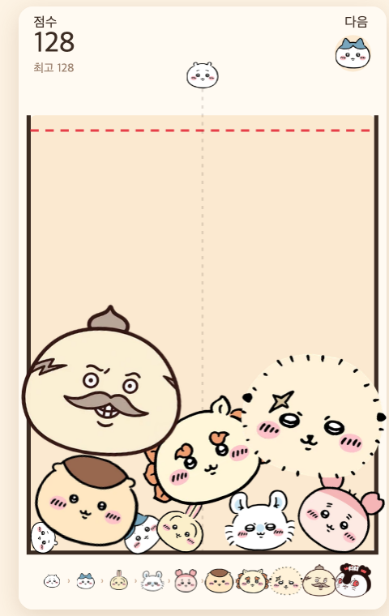

# 치이카와 합치기 — 소프트웨어 테스트 결과 보고서

> 이 문서는 `python3 tests/run_tests.py` 가 자동 생성합니다. 직접 수정하지 마세요.

## 1. 실행 정보

| 항목 | 값 |
|---|---|
| 실행 일시 | 2026-11-01T20:38:43+09:00 |
| 대상 파일 | `chiikawa-merge.html` |
| 대상 SHA-256 | `20f672530e851d1d…` |
| 대상 커밋 | d5fc39d |
| 실행 환경 | Google Chrome 156.0.8078.74 (헤드리스, 네트워크 차단) / Darwin 25.6.0 |
| 실행 변형 | default, stored, nostorage |

## 2. 요약

| 전체 | 통과 | 실패 | 오류 | 통과율 |
|---|---|---|---|---|
| 34 | 34 | 0 | 0 | 100.0% |

## 3. 테스트 케이스별 결과

| TC ID | 제목 | 검증 SR | 변형 | 결과 | 소요(ms) |
|---|---|---|---|---|---|
| TC-001 | 캐릭터 10단계와 반지름 정의 | SR-001 | default | ✅ 통과 | 0 |
| TC-002 | 드롭 캐릭터는 0~4단계 중 무작위 | SR-002 | default | ✅ 통과 | 0 |
| TC-003 | 포인터 이동/누름으로 조준 위치 갱신 | SR-003 | default | ✅ 통과 | 0 |
| TC-004 | 포인터를 떼면 그 위치에 드롭 | SR-003 | default | ✅ 통과 | 0 |
| TC-005 | ←/→ 키로 조준 12px 이동 | SR-004 | default | ✅ 통과 | 0 |
| TC-006 | Space/↓ 키로 드롭, 기본 동작 차단 | SR-004 | default | ✅ 통과 | 600 |
| TC-007 | 드롭 위치를 벽 안쪽으로 제한 | SR-005 | default | ✅ 통과 | 600 |
| TC-008 | 키 조준은 이동 범위 밖으로 누적되지 않음 | SR-005 | default | ✅ 통과 | 0 |
| TC-009 | 드롭 후 550ms 쿨다운과 다음 캐릭터 승계 | SR-006, SR-012 | default | ✅ 통과 | 650 |
| TC-010 | 같은 단계가 닿으면 다음 단계 1개로 합체 | SR-007, SR-010 | default | ✅ 통과 | 0 |
| TC-011 | 서로 다른 단계는 합체하지 않음 | SR-008 | default | ✅ 통과 | 0 |
| TC-012 | 한 캐릭터는 한 번만 합체 (3개 동시 접촉) | SR-009 | default | ✅ 통과 | 0 |
| TC-013 | 단계별 합체 점수 (t+1)(t+2)/2 | SR-010 | default | ✅ 통과 | 0 |
| TC-014 | 최고 단계 두 개 합체 시 소멸 + 200점 보너스 | SR-011 | default | ✅ 통과 | 0 |
| TC-015 | 합체 이펙트 (파티클 14개 + 링) | SR-019 | default | ✅ 통과 | 0 |
| TC-016 | HUD에 점수·최고 기록·다음 캐릭터 표시 | SR-012 | default | ✅ 통과 | 0 |
| TC-017 | 저장된 최고 기록을 시작 시 불러옴 | SR-013 | stored | ✅ 통과 | 0 |
| TC-018 | 게임 오버 시 최고 기록 갱신·저장 | SR-013 | default | ✅ 통과 | 0 |
| TC-019 | 저장소 사용 불가 환경에서도 정상 동작 | SR-013 | nostorage | ✅ 통과 | 0 |
| TC-020 | 위험선 초과 상태 2.2초 지속 시 게임 오버 | SR-014 | default | ✅ 통과 | 0 |
| TC-021 | 생성 1.2초 이내 캐릭터는 판정 제외 | SR-014 | default | ✅ 통과 | 0 |
| TC-022 | 움직이는 캐릭터(속도≥1.5)는 판정 제외 | SR-014 | default | ✅ 통과 | 0 |
| TC-023 | 위험 해소 시 타이머가 2배 속도로 감소 | SR-014 | default | ✅ 통과 | 0 |
| TC-024 | 게임 오버 화면과 진행 정지 | SR-015 | default | ✅ 통과 | 0 |
| TC-025 | 다시 하기로 초기 상태 복귀 | SR-016 | default | ✅ 통과 | 0 |
| TC-026 | 화면 크기에 맞춘 비율 유지 스케일과 DPR 대응 | SR-017 | default | ✅ 통과 | 0 |
| TC-027 | 단일 파일 구성 (엔진·이미지 내장) | SR-018 | default | ✅ 통과 | 0 |
| TC-028 | 오프라인(폰트 미수신)에서도 시작·렌더링 | SR-018 | default | ✅ 통과 | 0 |
| TC-029 | 이미지 미로딩 시 색상 원으로 대체 | SR-019 | default | ✅ 통과 | 0 |
| TC-030 | 하단 진화 단계 10종 표시 | SR-020 | default | ✅ 통과 | 0 |
| TC-031 | 위험선 표시 및 위험 시 강조 | SR-021 | default | ✅ 통과 | 0 |
| TC-032 | 프레임 간격 33ms 상한 | SR-022 | default | ✅ 통과 | 0 |
| TC-033 | requestAnimationFrame 기반 연속 루프 | SR-022 | default | ✅ 통과 | 0 |
| TC-034 | 모바일 확대/스크롤/선택 방지 | SR-023 | default | ✅ 통과 | 0 |

## 4. 실패/오류 상세

없음.

## 5. 증적

플레이 화면 (헤드리스 Chrome, 오프라인):

추적성(요구사항 ↔ 테스트 결과)은 [traceability-matrix.md](traceability-matrix.md) 를 참고하세요.
